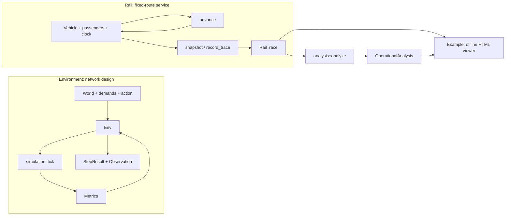

# Architecture

`urbanflow` has two independent simulation paths: `Env` evaluates network-building actions through aggregate demand allocation; `rail` models one vehicle's timed service. `Env::step` neither advances Rail movement nor uses its results.

See [README](README.md) for usage, [AGENTS](AGENTS.md) for contributor rules, and each module's rustdoc for API and error contracts.

## Overview

Core outputs own their data. Consumers can retain observations and replay traces without borrowing live state or making simulation decisions.

The [scenario file contract](SCENARIO_FORMAT.md) defines versioned consumer inputs for either Env or Rail. The [`scenario` consumer adapter](examples/scenario/mod.rs) reads UTF-8 JSON, checks the version before interpreting its fields, preserves array order, and converts decimal strings through checked `u64`/`usize` conversions. Edge IDs remain insertion indices. Serde, serde_json, and serde_path_to_error are development dependencies used only at this boundary; the core has no configuration hierarchy or serialization dependency.

Loading returns a validated `Env` or a `RailScenario` containing the world, vehicle, passengers, tick-zero clock, and recording limit. `Network::add_edge`, `Env::validate_inputs` (including `World::validate_topology` and demand endpoints for both kinds), `Env::new`, `RailRoute::new`, and `RailVehicle::new` own simulation validation. The adapter adds strict file-shape/numeric checks and file/field diagnostics. It exposes no partial state on failure and performs no actions, ticks, analysis, or output writes.

The [result adapter](examples/results/mod.rs) owns versioned Rail result persistence independently of scenario loading. It reuses the viewer payload, enforces the [result format](RESULT_FORMAT.md)'s byte limit, numeric bounds, topology references, and recording consistency, and reconstructs owned `World`/`RailTrace` values without simulation. Complete-trace analysis uses the core API; partial traces receive consumer-side consistency checks because core analysis requires completion. Imported analysis is discarded and recomputed, with missing initial history represented by no analysis. Loading checks canonical output size with that recomputed analysis before returning state. Validation does not certify every movement or boarding rule. Validation and encoding finish before opening output files; there is no core serialization hierarchy or new dependency.

## Module Map

All modules are public except `simulation`.

| Modules                                                                                               | Responsibility                                                   |
| ----------------------------------------------------------------------------------------------------- | ---------------------------------------------------------------- |
| [`world`](src/world.rs), [`demand`](src/demand.rs)                                                    | Topology, mode capacities and costs, passenger demand            |
| [`network`](src/network.rs)                                                                           | Derived adjacency and directed shortest paths                    |
| [`simulation`](src/simulation.rs)                                                                     | Aggregate capacity allocation and metrics                        |
| [`env`](src/env.rs), [`action`](src/action.rs)                                                        | Scenario lifecycle, actions, episodes, rewards                   |
| [`time`](src/time.rs)                                                                                 | Checked integer simulation clock                                 |
| [`rail`](src/rail.rs)                                                                                 | Routes, vehicle movement, passenger lifecycle, snapshots, traces |
| [`analysis`](src/analysis.rs)                                                                         | Validation and operational summaries of completed Rail traces    |
| [`metrics`](src/metrics.rs), [`observation`](src/observation.rs), [`step_result`](src/step_result.rs) | Owned environment outputs                                        |

## Execution Flows

### Environment

`Env::new` validates and retains the initial scenario. Each `step` validates an action before adding an edge, deducting its cost, allocating demand, and returning metrics, reward, and an observation. `reset` restores the scenario for repeatable episodes. Input order, error precedence, and reset semantics are specified in the [Env API](src/env.rs).

### Rail Service

The caller keeps a vehicle, clock, and passenger set together. `advance` coordinates one atomic tick of movement and stop processing; `snapshot` copies the state, and `record_trace` records bounded advances. A partial trace retains its last state without forcing unfinished journeys to complete.

Rail uses fixed travel/dwell durations and aggregate passenger counts. Vehicle capacity is independent of network edge capacity; movement uses neither shortest-path routing nor congestion. Simulation ticks have no wall-clock unit or pacing policy. See the [Rail API](src/rail.rs) for timing and passenger contracts.

### Scenario CLI

The [`run_scenario` consumer](examples/run_scenario/mod.rs) connects scenario loading to `RailVehicle::record_trace`, the result encoder, and optional offline viewer rendering. It passes the file's `max_ticks` directly to recording, retains partial state, and uses the existing result adapter for validation and analysis. Env files are rejected because the CLI has no action policy or Env result contract.

All computation finishes before output staging. The CLI rejects resolved input/output aliases and equal output paths, stages files beside their destinations, and renames HTML before JSON. Each file replacement is atomic; the pair is not transactional, so a final JSON rename failure may leave updated HTML. Ordinary failures clean up temporary files. CLI I/O and exit behavior stay outside the core; the adapter's standalone `save` API retains its documented ordinary-write semantics. See [command usage](README.md#run-a-scenario-file).

### Operational Result Contracts

Every analysis requires a completed trace; `analyze` and `StopActivity::from_trace` additionally require every tick from stop zero with all passengers initially waiting, while other summaries accept partial history.

`analysis::analyze` validates once and combines the same calculations used by individual `from_trace` summaries. It returns owned results without advancing service or reconstructing missing history. Units, history requirements, undefined denominators, and errors belong in [analysis rustdoc](src/analysis.rs); the [executable example](examples/operational_analysis.rs) demonstrates the workflow.

## Simulation Contracts

- Edges are directed. Return connections have their own construction cost; self-connections and same-mode duplicates are rejected. Road and Rail may share an ordered node pair.
- Demands consume capacity in stored order along the first shortest path by hop count, with ties resolved by edge insertion order. The path's smallest remaining capacity limits service; excess and unreachable demand are unserved.
- Congestion is the maximum edge load/capacity ratio, or zero without edges. Cost sums construction costs. Reward is `served demand - unserved demand - congestion - cost`.
- Invalid actions and overflow are detected before mutation. A failed Rail tick preserves vehicle, clock, and passengers together. Rail lifecycle counts always conserve each original demand, including duplicates and zero amounts.

## Training Consumers

[`random_policy`](examples/random_policy.rs) and [`tabular_q_learning`](examples/tabular_q_learning.rs) use the public Env API with fixed seeds and one step per episode. Policy state stays outside the core; the learner stores one value per action, with no general state table or multi-step training loop.

## Browser Consumer

The [`rail_viewer` example](examples/rail_viewer.rs) records service before generating one offline HTML file. Its [Rust module](examples/rail_viewer/mod.rs) calls the shared result encoder and escapes the JSON for an HTML script element; its [template](examples/rail_viewer/viewer.html) owns layout, playback, and formatting. Identical inputs produce identical traces and HTML.

Playback reads fixed snapshots and never advances simulation. Only the vehicle marker is interpolated; status follows recorded ticks, and analysis stays fixed. IDs and `u64` values remain exact through string serialization and `BigInt` passenger totals. Partial traces and completed traces missing initial history remain viewable without analysis; other analysis errors prevent file writing. See [README](README.md#browser-viewer) for execution and the consumer's rustdoc for display contracts.

## Planned Direction

Current Rail service has one fixed-route vehicle. Multiple vehicles/routes, automatic reverse service, timetables, headways, transfers, Tram/DRT service, road traffic (signals, lanes, congestion-driven movement), and GIS maps remain deferred.

Broader analysis, statistical experiments, confidence intervals, optimization, large-scale low-latency simulation, and application integrations are also planned. Dataframes, databases, query engines, charting dependencies, hosted dashboards, web servers, WebAssembly, and frontend frameworks are outside the current workflow.

Future interfaces should use the public API and keep rendering, coordinates, serialization, storage, and transport in consumer layers. Add modules only for concrete requirements.
